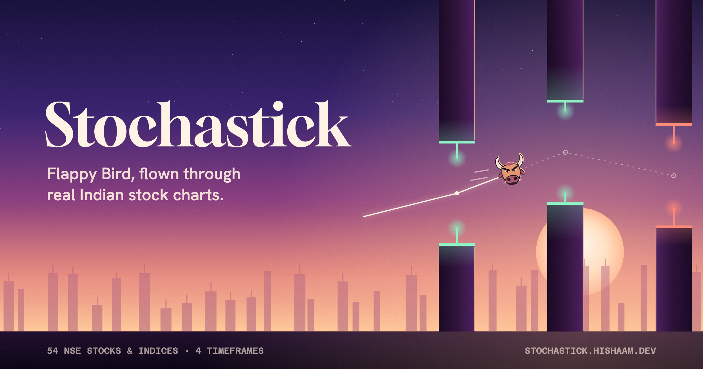

<!-- markdownlint-disable MD033 -->

<p align="center">
  
</p>

## Stochastick

Flappy Bird played on real Indian stock market candlestick charts, at dusk. Pick a stock, pick a timeframe, survive the chart.

**Play it: [stochastick.hishaam.dev](https://stochastick.hishaam.dev)**

No backend, no accounts, no API keys at runtime — a fully static site that ships the market data with it.

## What It Does

- Fly a bull or a bear through any of 54 NSE instruments (Nifty 50 constituents + NIFTY 50, BANK NIFTY, SENSEX) on 15m, 1h, Daily or Weekly candles
- The stock's real price history is the level: each candle is a pair of monoliths, the gap tracks the close, and the gap-facing ends show the candle's real body and wicks in green or red
- The sky follows the market: a rally lifts the sun toward golden hour, a sell-off sinks it toward night
- A strip at the bottom shows the whole chart and where you are in it
- Fair on every screen: a phone sees at least as much of the chart ahead as anyone else, and far candles dissolve into haze on wide screens
- Crash and the card shows the real date you got rekt, the price move over your run, and your best; share it as an image
- The landing page runs an autopilot through real NIFTY 50 history behind the title
- Best scores are kept per stock × timeframe in `localStorage`

## Tech Stack

[](https://vitejs.dev/)
[](https://svelte.dev/)
[](https://developer.mozilla.org/en-US/docs/Web/API/WebGL2RenderingContext)
[](https://www.typescriptlang.org/)
[](https://vitest.dev/)
[](https://developer.mozilla.org/en-US/docs/Web/API/Canvas_API)
[](https://vercel.com/)
[](https://www.gnu.org/licenses/gpl-3.0)

## Quick Start

```bash
npm install
npm run dev
```

Then open the URL Vite prints (default [http://localhost:5173](http://localhost:5173)).

## Dev

```bash
npm run dev          # local dev server
npm test             # Vitest: physics, level generation, codec round-trip, collision, state machine
npm run build        # tsc --noEmit && vite build -> dist/
npm run fetch-data   # re-pull candle data from Yahoo Finance -> public/data/*.bin + manifest.json
```

The production build is about 37 kB gzipped of JS plus 4 kB of CSS; fonts are self-hosted and the market data ships as compact binary files.

## How It Works

Each candle becomes a pair of monoliths: one standing on the horizon, one hanging from the sky. The gap between them tracks the candle's close, rolling-normalized against its neighbours, so a rally climbs the level and a crash sends the gap diving toward the ground. The close-to-close line threads every gap: the chart you are flying.

Level generation is unit-tested against an invariant: **any** real (or adversarial synthetic) price series produces a completable level. Gap size is clamped to a playable range, and no single step exceeds what the flap physics can reach.

The look, "Afterglow": a WebGL2 dusk sky (dithered, so the gradient never bands), a skyline built from the stock's own history in layered haze, frosted-glass panels, and three typefaces: Gloock for moments, Hanken Grotesk for interface, Azeret Mono for market data.

## Scripts

| Command | When to use |
|--------|-------------|
| `npm run dev` | Local development server |
| `npm test` | Run the Vitest unit tests |
| `npm run build` | Type-check and bundle to `dist/` |
| `npm run fetch-data` | Re-pull candle data from Yahoo Finance (no API key) |
| open `/scripts/og-image.html` on the dev server | Re-render `public/og-image.png` from real NIFTY 50 data |

## Project Structure

```
src/
  App.svelte          # screens, routing (landing → picker → game), keyboard, share
  app.css             # Afterglow tokens: palette, type, sizing system
  data/               # candle types, STK1 codec, loaders, manifest schema
  game/               # pure game logic: physics, level, collision, state, loop, autopilot, audio
  render/
    sky.ts            # WebGL2 dusk sky shader
    scene.ts          # Canvas 2D world: skyline, candle monoliths, price line, fighter, particles
    view.ts           # world → screen mapping (fair look-ahead)
    fighters.ts       # bull and bear heads, lit for dusk
    postcard.ts       # share card and OG image
  lib/                # engine (canvases + clock), app state, formatting, storage
  ui/                 # Landing, Picker, Hud, DeathCard, FighterToggle, Icon
scripts/
  fetch-data.ts       # Yahoo Finance → public/data/*.bin + manifest.json (with split/demerger fixes)
  og-image.html       # dev-only OG image renderer
```

## Data

Baked at build time, not fetched at runtime. `npm run fetch-data` (`scripts/fetch-data.ts`) pulls OHLC candles from Yahoo Finance's public chart API for the full universe of instruments and every timeframe, then writes:

- `public/data/<SYMBOL>_<TF>.bin` — a compact binary file per stock × timeframe, custom **STK1** format: a 4-byte magic number, a 4-byte candle count, a run of `uint32` timestamps, then a run of `int32` OHLC values in paise (rupees × 100) — about 20 bytes per candle.
- `public/data/manifest.json` — the stock list with names, index flags, sparkline previews, last close, 1-month change, and per-timeframe candle counts and date ranges, loaded once at startup.

Yahoo leaves a few corporate actions unadjusted (an intraday split, a demerger); the script rescales the bars before them so the level shows market moves, not mechanical resets.

There's no API key and no server involved; the script just writes static files into `public/`. The shipped data is a frozen snapshot — re-run `npm run fetch-data` to refresh it.

## Disclaimer

This is a game, not a trading terminal — nothing here is financial advice. Market data is sourced from Yahoo Finance's public chart API; accuracy is not guaranteed, and the shipped data is a static snapshot, not a live feed.

## Deployment

Static output in `dist/`, deployed on Vercel at [stochastick.hishaam.dev](https://stochastick.hishaam.dev). Pushes to `main` auto-deploy.

## Contributor

- Md Hishaam Akhtar

<p align="center">
  Built for traders who want to get rekt virtually first.
</p>